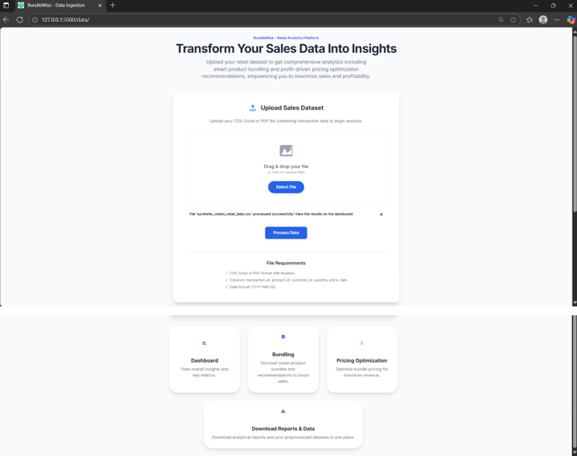
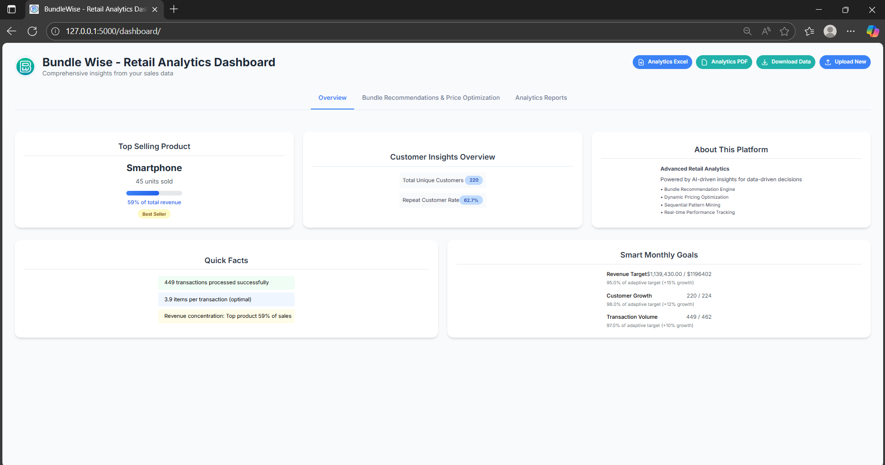
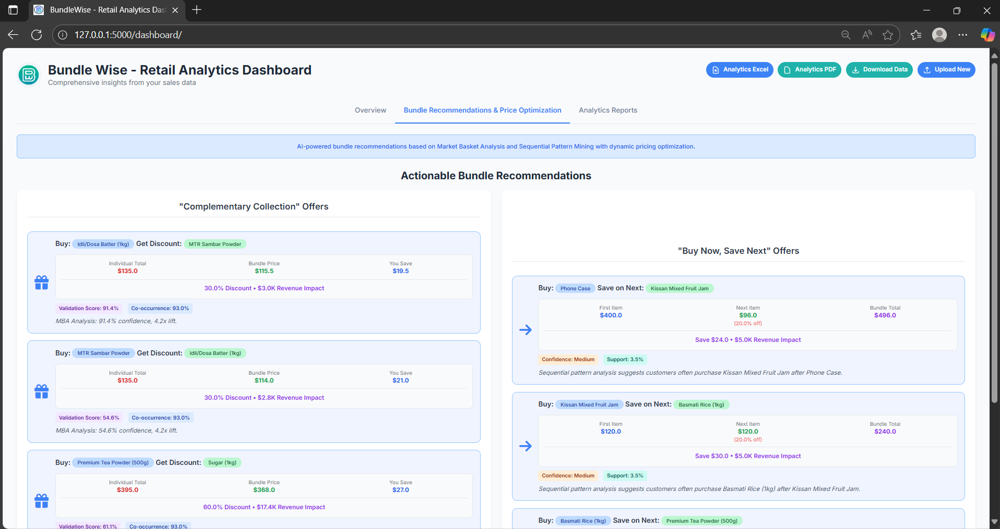
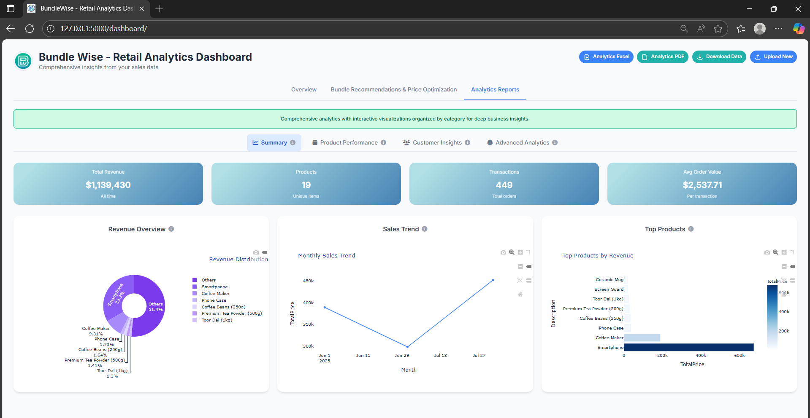
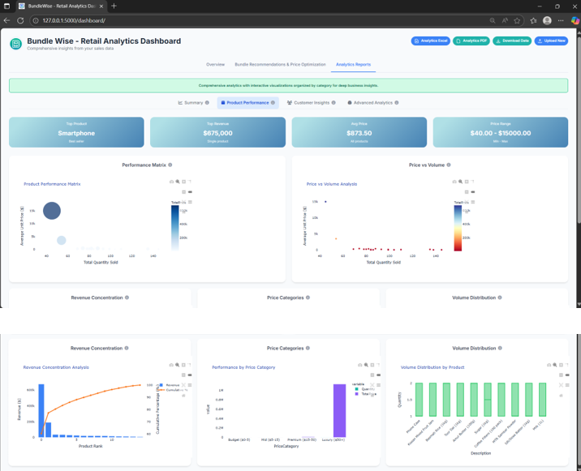
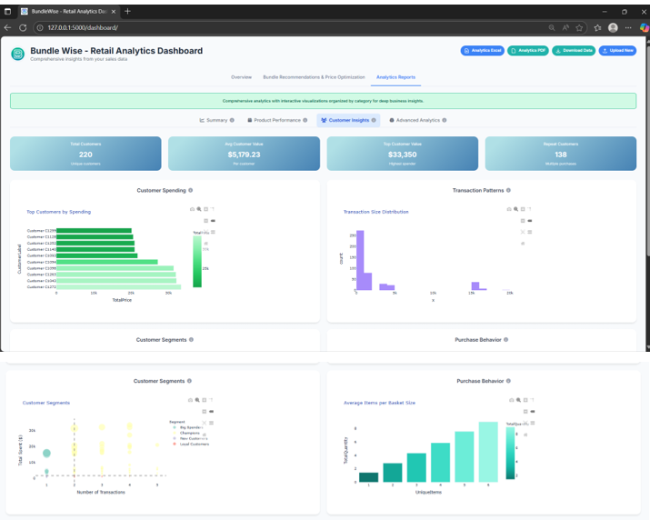
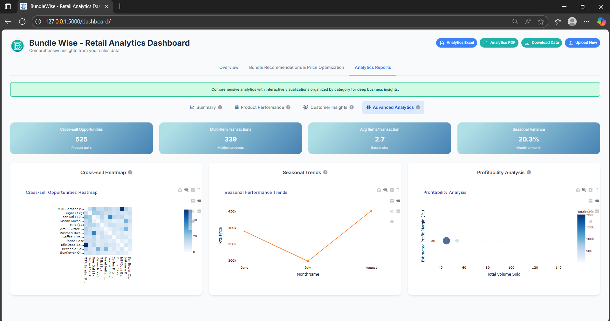

# BundleWise – Retail Analytics Platform

BundleWise is a web-based retail analytics application built with Python and Flask. It helps retailers turn transaction data into useful business insights by identifying products that are frequently purchased together, exploring customer purchase sequences, reviewing pricing recommendations, and analysing sales and customer performance through an interactive dashboard.

The project was developed as an academic prototype with a focus on making retail analytics more accessible to small and medium-sized businesses.

## Key Features

### 1. Data Upload and Preprocessing
- Upload retail transaction data in CSV, Excel (`.xlsx` / `.xls`), or PDF format.
- Validate uploaded files against the expected transaction fields.
- Standardise recognised column names and prepare data for analysis.
- Download or review processed data where supported by the application.

### 2. Market Basket Analysis
- Identify products that are frequently purchased together.
- Generate product association rules to help discover cross-selling and bundling opportunities.
- Present association results using measures such as support, confidence, and lift.

### 3. Sequential Pattern Mining
- Explore the order in which customers purchase products across transactions.
- Use a PrefixSpan-based implementation to discover recurring purchase sequences.
- Present frequent sequences and supporting visualisations.

### 4. Pricing and Bundle Recommendations
- Provide pricing suggestions for recommended product bundles.
- Support complementary-product offers and offers based on subsequent purchases.
- Help retailers explore potential discounts and cross-selling strategies.

### 5. Interactive Analytics Dashboard
The dashboard is organised into four main analytical areas:

- **Summary:** High-level business metrics and sales overview.
- **Product Performance:** Product sales, revenue contribution, and performance patterns.
- **Customer Insights:** Customer purchasing behaviour and customer-level insights.
- **Advanced Analytics:** Additional sales trends, relationships, and analytical visualisations.

### 6. Reports
The project includes reporting functionality intended to make selected analytics available outside the application, including PDF and Excel outputs.

## Application Screenshots

The following screenshots show the main interfaces of BundleWise.

### 1. Data Upload and Validation



### 2. Dashboard Overview



### 3. Bundle Recommendations and Pricing Optimisation



### 4. Summary Reports Dashboard



### 5. Product Performance Dashboard



### 6. Customer Insights Dashboard



### 7. Advanced Analytics Dashboard



## Technology Stack

| Area | Technologies |
|---|---|
| Programming language | Python |
| Web framework | Flask |
| Data processing | Pandas, NumPy |
| Market Basket Analysis | Frequent itemset mining and association-rule analysis |
| Sequential Pattern Mining | PrefixSpan |
| Data visualisation | Matplotlib, Seaborn, Plotly |
| File handling | CSV, Excel, PDF |
| PDF table extraction | Tabula-py |
| Excel reporting | OpenPyXL / XlsxWriter |
| PDF reporting | ReportLab |

## Project Structure

```text
BundleWise/
│
├── app.py
│
├── data_ingestion/
│   ├── __init__.py
│   ├── processor.py
│   ├── routes.py
│   └── utils.py
│
├── mba_analysis/
│   ├── __init__.py
│   └── routes.py
│
├── spm_analysis/
│   ├── __init__.py
│   ├── prefixspan.py
│   └── routes.py
│
├── dashboard_analysis/
│   └── routes.py
│
├── templates/
│   ├── dashboard.html
│   ├── data_ingestion.html
│   ├── mba_analysis.html
│   └── spm_analysis.html
│
├── screenshots/
│   ├── 01-data-upload.png
│   ├── 02-high-level-dashboard-overview.png
│   ├── 03-bundle-recommendations-with-optimization.png
│   ├── 04-summary-reports-dashboard.png
│   ├── 05-product-performance-dashboard.png
│   ├── 06-customer-insights-dashboard.png
│   └── 07-advanced-insights-dashboard.png
│
├── uploads/
├── requirements.txt
└── README.md
```

## Getting Started

### Prerequisites

Make sure the following are installed:

- Python 3.9 or later
- pip (Python package installer)
- Java Runtime Environment, if you intend to process PDF files using Tabula-py

### 1. Clone the repository

```bash
git clone https://github.com/<your-username>/BundleWise.git
cd BundleWise
```

Replace `<your-username>` with your GitHub username.

### 2. Create a virtual environment

**Windows:**

```bash
python -m venv venv
venv\Scripts\activate
```

**macOS / Linux:**

```bash
python3 -m venv venv
source venv/bin/activate
```

### 3. Install dependencies

```bash
python -m pip install --upgrade pip
pip install -r requirements.txt
```

### 4. Run the application

From the project directory containing `app.py`, run:

```bash
python app.py
```

Once the Flask application starts, open the following address in your browser:

```text
http://127.0.0.1:5000/
```

The application opens the data upload page. Upload a supported retail transaction file to begin exploring the analysis modules and dashboard.

## Input Data Format

BundleWise expects transaction-level retail data with the following fields:

| Column | Description |
|---|---|
| `Transaction ID` | Unique identifier for an invoice or transaction |
| `Product ID` | Identifier for the purchased product |
| `Date/Timestamp` | Date and time of the transaction |
| `Quantity` | Number of units purchased |
| `Price Per Unit` | Selling price per unit |
| `Customer ID` | Identifier for the customer |
| `Description` | Optional product name or description |

The ingestion module recognises some common Online Retail dataset column names, including `InvoiceNo`, `StockCode`, `InvoiceDate`, `UnitPrice`, `CustomerID`, and `Description`, and maps them to the application's standard column names.

For PDF uploads, the file should contain a readable transaction table. PDF extraction results can vary depending on the structure and layout of the source document.

## How the Application Works

1. **Upload:** The user uploads a retail transaction file.
2. **Preprocess:** The application reads the file, standardises recognised column names, validates required fields, and prepares the data.
3. **Analyse baskets:** Market Basket Analysis identifies product combinations and association rules.
4. **Analyse sequences:** Sequential Pattern Mining explores recurring product purchase sequences.
5. **Review recommendations:** The application presents bundle and pricing suggestions.
6. **Explore insights:** The dashboard displays summary, product, customer, and advanced analytics.
7. **Export reports:** Available reporting features provide outputs for further review and sharing.

## Team and project context

BundleWise was developed as an MSc Data Science academic project at CHRIST (Deemed to be University), Bengaluru, under the guidance of Dr. Apas Roy.  
Team Members: Abishai Tom, Liya Khatija and Mansi Sapariya
